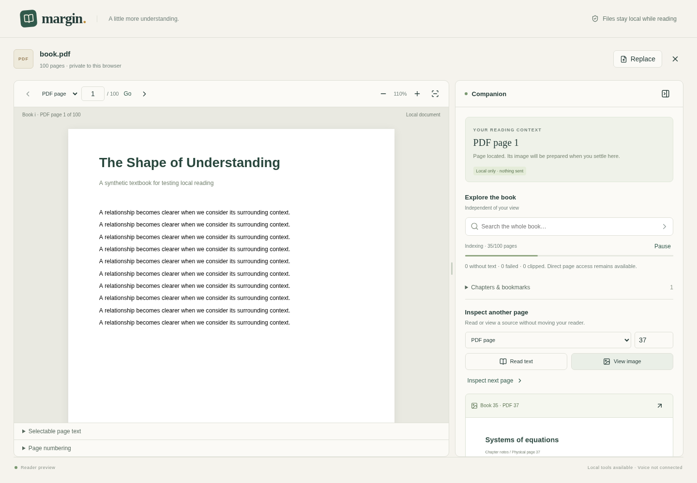

# Margin — PDF and Excel Voice Companion

The first working increment of a local document reader with an independent research panel. Open a PDF, keep your place, and inspect a different page or chapter without moving your view.

**Status:** PDF reader/research foundation. Excel, voice, provider integration, private server access, and spending admission are planned and are not implemented. No microphone or AI connection is opened by this version.



## Run

Use Node.js 24 (Node 22.13+ is supported by the dependency toolchain).

```sh
npm ci
npm run dev
```

The development server binds to the local machine on port 5173. Open its address in a local browser when running outside cloud onboarding. No environment secrets are required for this increment. PDF workers, fonts, CMaps, and codecs are served locally; reading does not upload the document.

In the managed cloud workspace, use a writable npm cache:

```sh
cd /workspace/voice
npm_config_cache=/workspace/.cache/npm npm ci
npm run dev
```

## What works

- Local PDF loading with a 20 MiB file limit and 3,000-page ceiling.
- Actual page rendering, physical page navigation, zoom, fit width, and a clearly labelled selectable extracted-text fallback.
- PDF-provided book labels, including Roman front matter and ambiguous-label rejection; individual local label corrections. Unlabelled pages are not silently treated as known printed labels.
- Progressive keyword search with pause/resume, coverage counts, and bounded index entries.
- Direct text/image retrieval independent of indexing progress, PDF outline lookup, and sequential next-page research.
- Source-linked research results; explicit navigation and return-to-reading-position controls.
- Separate foreground and background state, local image preparation after a 2.5-second dwell, and cancellation on page/document changes.
- Responsive layout, keyboard-operable divider, collapsible research panel, and clear/replace teardown.

Book labels are metadata, not verified OCR of printed numbers. Outline entries are bookmarks, not a guaranteed chapter catalog. Keyword search is not semantic search. The research panel exposes the local tools that the future assistant will use; it does not produce AI answers or claim to understand figures.

## Checks

```sh
npm run test          # unit tests
npm run build         # TypeScript and production build
npm run test:browser  # generates synthetic PDFs and starts the app
npm run format:check
```

Browser tests use `/usr/bin/chromium` by default in this cloud machine. Set `CHROMIUM_PATH` to your browser executable on another machine. Tests use headless Chromium with its sandbox disabled inside the isolated test container; this is test-runner configuration, not a production browser recommendation.

`npm run fixtures` regenerates the synthetic books in ignored `public/fixtures`. All examples contain generated test content. No personal documents are included. See [validation evidence](docs/validation.md).

## Remaining work and limitations

See the [implementation plan](docs/implementation-plan.md) for the complete release sequence.

- Excel parsing, workbook tools, natural voice, authentication, durable spending controls, and provider compatibility are subsequent milestones.
- Automatic chapter inference, diagram discovery by description/order, OCR, crops, semantic search, and multi-source AI comparison are not implemented.
- Labels can be corrected per page; range/offset correction, mapping provenance, and inferred printed-number extraction remain pending.
- The first PDF page currently waits for label/outline discovery. Very complex outlines and large files need profiling and a foreground-first loading refinement.
- Text uses an extracted-text fallback, not an aligned selectable text layer. Selection-to-question context is pending.
- Index term/posting counts and text caches are bounded, but fixed-memory index arenas and a strict four-page PDF resource scheduler are not implemented. The 3,000-page ceiling is a guard, not a performance certification. Full hostile-document and memory-stress validation remains pending.
- A pixel/byte bound limits page images; crop-based recovery for pages that exceed the image limit is pending.
- The local source registry retains the most recent twelve sources; sources are cleared with the document and are not persisted.
- Chromium desktop and a mobile-sized viewport were tested. Physical phone, microphone, loudspeaker, Safari, Firefox, and live visual-answer acceptance tests have not run.

No production deployment or paid model call has been performed. This build is a local reader preview, not the complete product.
